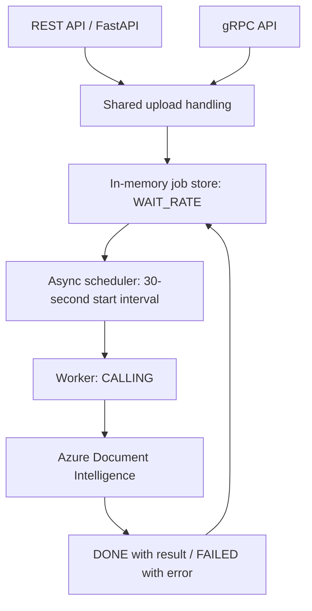

# Invoice Processing Service

A Python service that extracts structured invoice data from PDFs using **Azure AI
Document Intelligence**. REST and gRPC expose the same asynchronous processing
pipeline, with a scheduler that spaces request starts by **30 seconds**.

Built as a distributed systems laboratory project at **Kaunas University of
Technology (KTU)**. The focus is API integration, asynchronous task scheduling,
and explicit job state transitions.

**Stack:** Python · FastAPI · asyncio · gRPC · Protocol Buffers · Azure AI Document
Intelligence · pytest

## What it does

- Accepts PDF uploads through REST or gRPC and assigns each job a UUID.
- Processes jobs in the background while clients poll their status.
- Extracts invoice ID, date, vendor, totals, currency, and line items.
- Enforces allowed state transitions and records processing errors.
- Provides a gRPC CLI for submission, polling, listing, and deletion.

## Architecture



Both servers and the scheduler run in **one Python process**, sharing the same
in-memory store. The synchronous Azure SDK runs in a background thread through
`asyncio.to_thread`, keeping the event loop available for API requests.

```text
WAIT_RATE → CALLING → DONE
                   → FAILED
```

`DONE` and `FAILED` are terminal states. A worker has a 60-second waiting timeout.
The scheduler limits the interval between starts; it does not guarantee that only
one Azure operation is in progress at a time.

## Run locally

Prerequisites: Python 3.10+ (CI uses 3.12), an Azure AI Document Intelligence
resource, and a PDF invoice you are allowed to upload to Azure. Live analysis
requires network access and can incur Azure usage charges.

Download or clone this repository, open its directory, then run these Linux/macOS
commands:

```bash
python3 -m venv .venv
source .venv/bin/activate
python -m pip install -r requirements.txt
cp .env.example .env
```

Fill in `DI_ENDPOINT` and `DI_KEY` in `.env` with your Azure resource endpoint and
key. Keep `.env` private. Start the application from the repository root:

```bash
uvicorn app.main:app
```

| Interface | Address |
| --- | --- |
| REST API | http://127.0.0.1:8000 |
| Interactive Swagger UI | http://127.0.0.1:8000/docs |
| gRPC | `127.0.0.1:50051` |

Use a single Uvicorn worker. Each additional process would have a separate job
store. Set `GRPC_ADDRESS` in the environment to override the gRPC bind address.

## Try the service

In another terminal, activate the environment and submit your own PDF:

```bash
source .venv/bin/activate
python grpc_client.py demo /path/to/invoice.pdf
```

The client submits the job, prints state changes, and retrieves the result. Its
default polling timeout is 180 seconds; queued requests may require a longer one:

```bash
python grpc_client.py demo /path/to/invoice.pdf --timeout 300
```

For REST, upload a PDF and use the returned `req_no` to poll:

```bash
curl -F "file=@/path/to/invoice.pdf" http://127.0.0.1:8000/jobs
curl http://127.0.0.1:8000/jobs/REQUEST_ID/status
curl http://127.0.0.1:8000/jobs/REQUEST_ID/result
```

Replace `REQUEST_ID` with the returned identifier. No invoice sample is shipped;
local invoices and uploads are excluded from Git.

## API reference

### REST

| Method | Endpoint | Purpose |
| --- | --- | --- |
| `GET` | `/` | Service greeting |
| `POST` | `/jobs` | Upload a PDF as multipart field `file` |
| `GET` | `/jobs/{req_no}/status` | Read the current state |
| `GET` | `/jobs/{req_no}/result` | Read a result, pending message, or failure |

Unknown job IDs return HTTP 404. Invalid uploads return HTTP 400.

### gRPC

The contract is defined in [`proto/invoice_service.proto`](proto/invoice_service.proto).

| RPC | CLI command | Purpose |
| --- | --- | --- |
| `CreateJob` | `python grpc_client.py create /path/to/invoice.pdf` | Submit a PDF |
| `GetJobStatus` | `python grpc_client.py status REQUEST_ID` | Read the state |
| `GetJobResult` | `python grpc_client.py result REQUEST_ID` | Read result or error |
| `ListJobs` | `python grpc_client.py list` | List job IDs and states |
| `DeleteJob` | `python grpc_client.py delete REQUEST_ID` | Delete a waiting or terminal job |

Use `--address HOST:PORT` before the subcommand to change the client destination.
Unknown jobs return `NOT_FOUND`; deleting a `CALLING` job returns
`FAILED_PRECONDITION`. Deletion removes the job record and retains its PDF.
Completed results are returned in the `result_json` string field. Pending jobs
have an empty `result_json`. Processing begins automatically through the scheduler.

## Tests

```bash
python -m pytest -q
```

The five existing tests cover successful completion, failure recording, terminal
states, and unique request IDs. They run without Azure credentials or network
access. GitHub Actions runs them on Python 3.12 and checks application imports
using placeholder credentials; it does not call Azure.

To verify the live Azure integration, configure your credentials, start the
application, and run the CLI demo with your own PDF. The local
`manual_azure_test.py` script is an additional diagnostic that expects
`invoice.pdf` in the repository root and calls Azure directly.

## Project structure

```text
app/                     REST API, shared store, scheduler, worker, Azure adapter
grpc_service/            gRPC server and generated Python bindings
proto/                   Protocol Buffers service contract
tests/                   State-machine invariant tests
docs/                    Interview walkthrough and publishing instructions
grpc_client.py           Command-line client for the five RPCs
manual_azure_test.py     Optional live Azure diagnostic
requirements.txt         Python dependencies
.env.example             Configuration template
.github/workflows/       Automated test workflow
```

Generated protobuf files are committed for convenience. After changing the
contract, regenerate them from the repository root instead of editing them:

```bash
python -m grpc_tools.protoc \
  -Igrpc_service=proto \
  --python_out=. \
  --grpc_python_out=. \
  proto/invoice_service.proto
```

## Scope and limitations

This is an educational prototype. Jobs disappear on restart, uploaded PDFs remain
on disk, and there is no automatic cleanup. The APIs have no authentication and
gRPC uses an insecure local channel. Upload validation checks the filename and
non-empty content, rather than parsing the PDF format. Timing uses the process
clock and an in-memory lock, rather than a distributed rate limiter. Timing out
the worker's wait does not forcibly stop the SDK operation in its background
thread.

For a production deployment, potential next steps include persistent storage,
a durable queue, authentication, file validation, and operational monitoring.
These are future improvements, not implemented features.

See the [interview walkthrough](docs/INTERVIEW.md) and
[GitHub publishing guide](docs/PUBLISHING.md).
